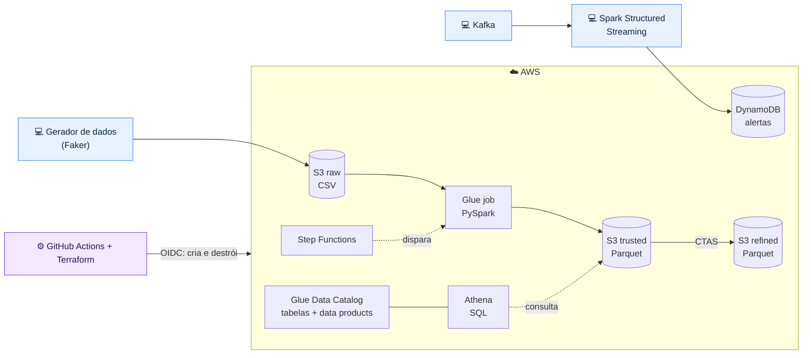

<div align="center">

# 💳 Data Engineering · Cartões

**Plataforma de dados de transações de cartão na AWS — do evento bruto ao data product governado.**

Data lake em camadas · Spark batch e streaming · Data Mesh com contratos · Infraestrutura 100% como código

[](https://codespaces.new/augustovitor/data-engineering-card)


</div>

---

## 📌 Sobre o projeto

Este projeto simula a área de dados de cartões de um banco. Transações chegam **em lote** e **em tempo real**, passam pelas camadas **raw → trusted → refined** de um data lake na AWS, são validadas por regras de qualidade e publicadas como **data products** com dono, contrato e classificação de dados pessoais.

O foco é o dia a dia de um time de Engenharia de Dados:

- 🏗️ **Ingestão resiliente** — escrita idempotente, reprocessamento sem duplicar, validação que bloqueia dado ruim
- ⚡ **Batch e streaming** — PySpark para cargas diárias e Spark Structured Streaming + Kafka para detecção de anomalias
- 🧭 **Data Mesh** — domínios publicam produtos a partir de contratos YAML; o CI barra contrato incompleto
- 🔐 **Governança e segurança** — PII sinalizada no catálogo, consumo por views pseudonimizadas, acesso à AWS via OIDC sem chaves
- 💰 **Custo sob controle** — tudo que é cobrado por hora roda fora da AWS; travas de custo no próprio código

> Todos os dados são **sintéticos**, gerados com [Faker](https://faker.readthedocs.io/). Nenhum dado real é utilizado.

---

## 🏛️ Arquitetura



<sub>💻 roda no GitHub Codespaces · ☁️ roda na AWS · ⚙️ pipeline de infraestrutura</sub>

| Camada | Conteúdo | Formato |
| --- | --- | --- |
| **raw** | Transações como chegaram da origem, particionadas por dia | CSV |
| **trusted** | Dados tipados, deduplicados e validados | Parquet |
| **refined** | Agregações prontas para consumo (gasto por cartão e categoria) | Parquet |

---

## 🧰 Stack

| Área | Tecnologias |
| --- | --- |
| Nuvem | AWS S3, Glue (jobs e Data Catalog), Athena, DynamoDB, Step Functions, IAM |
| Processamento | PySpark (batch e Structured Streaming) |
| Streaming | Apache Kafka |
| Infraestrutura como código | Terraform com módulos reutilizáveis e state remoto no S3 |
| CI/CD | GitHub Actions com autenticação OIDC na AWS |
| Qualidade e governança | Validações bloqueantes, contratos de dados em YAML, checkov |
| Ambiente | GitHub Codespaces (Dev Container) |

---

## 🗺️ Roadmap

- [x] Conta AWS segura, alertas de custo e ambiente de desenvolvimento
- [ ] Repositório, Codespaces e estrutura do projeto
- [ ] Bootstrap: state remoto e OIDC entre GitHub e AWS
- [ ] Data lake com Terraform (S3, Glue Catalog, Athena com limite de custo)
- [ ] CI/CD: plan em PR, apply com aprovação
- [ ] Geração de dados sintéticos e camada raw
- [ ] Processamento PySpark (local e AWS Glue) e camada refined
- [ ] Streaming com Kafka e alertas no DynamoDB
- [ ] Qualidade de dados e orquestração com Step Functions
- [ ] Data Mesh: contratos, data products e governança
- [ ] Evidências, custos finais e decisões de arquitetura

---

## 📁 Estrutura

```
data-engineering-card/
├── .devcontainer/        # ambiente de desenvolvimento (Codespaces)
├── .github/workflows/    # pipelines de CI e Terraform
├── infra/
│   ├── bootstrap/        # state remoto + OIDC
│   ├── modules/          # módulos Terraform reutilizáveis
│   └── envs/dev/         # ambiente de desenvolvimento
├── src/                  # gerador de dados e transformações
├── jobs/                 # jobs Spark batch e streaming
├── ingestao_lib/         # biblioteca de ingestão e qualidade
├── contratos/            # contratos dos data products
├── sql/athena/           # consultas e views
├── tests/
└── docs/                 # arquitetura, ADRs e evidências
```

---

## 💰 Decisões de custo

O projeto foi desenhado para custar centavos na AWS:

- **Partition projection** no catálogo em vez de crawlers
- **Limite de 100 MB por consulta** no workgroup do Athena
- **Glue Flex** com 2 workers, timeout de 10 minutos e sem agendamento
- **Kafka fora da AWS** (no Codespace) em vez de MSK; **DynamoDB on-demand**
- Ambiente **destruído após a validação** e recriável com um merge

---

## 🚀 Como executar

1. Abra o projeto no Codespaces pelo botão no topo desta página
2. Configure os secrets `AWS_ACCESS_KEY_ID`, `AWS_SECRET_ACCESS_KEY` e `AWS_DEFAULT_REGION`
3. Aplique o bootstrap em `infra/bootstrap`
4. Faça merge na `main` para o pipeline provisionar o ambiente

> Instruções detalhadas serão adicionadas em `docs/` conforme as etapas forem concluídas.

---

<div align="center">

**Vitor Augusto Mello da Silva**
Engenharia de Dados · Bacharelado em Ciência e Tecnologia (UFABC)

[](https://www.linkedin.com/in/SEU-PERFIL)
[](https://github.com/augustovitor)

</div>
